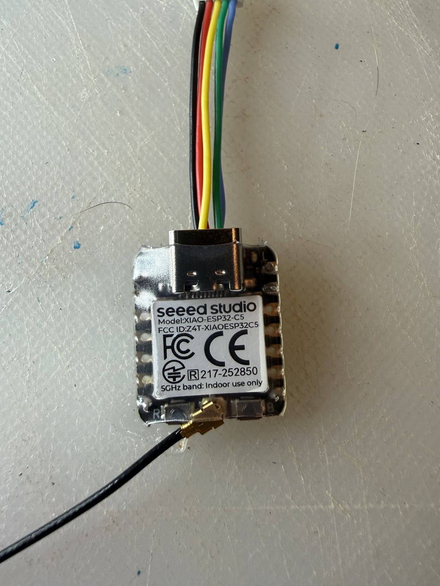
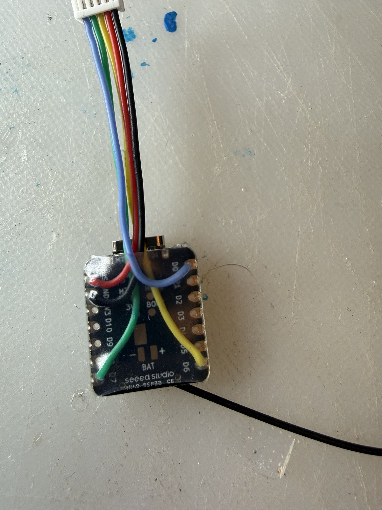
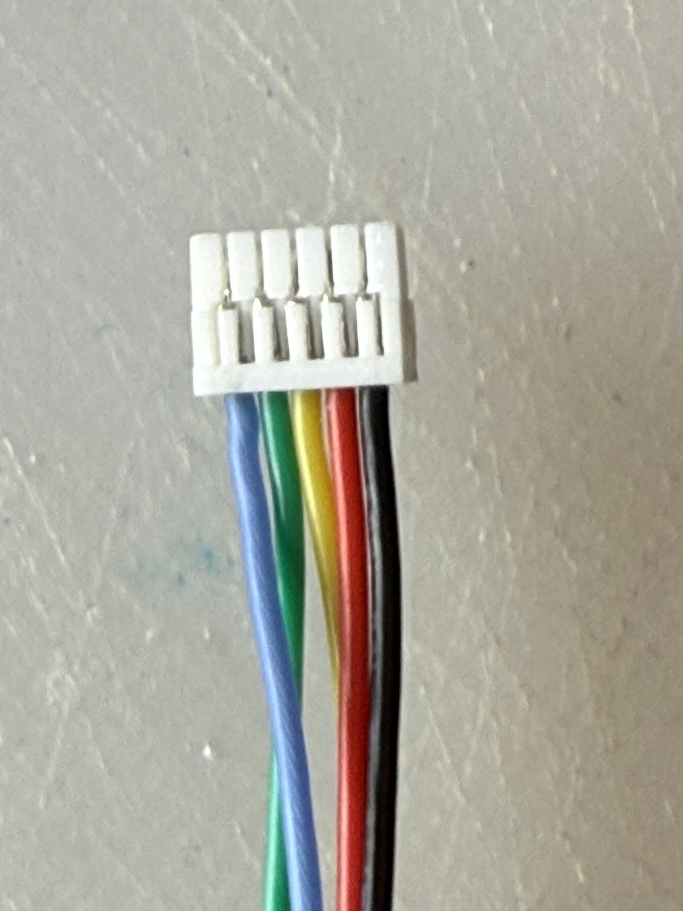
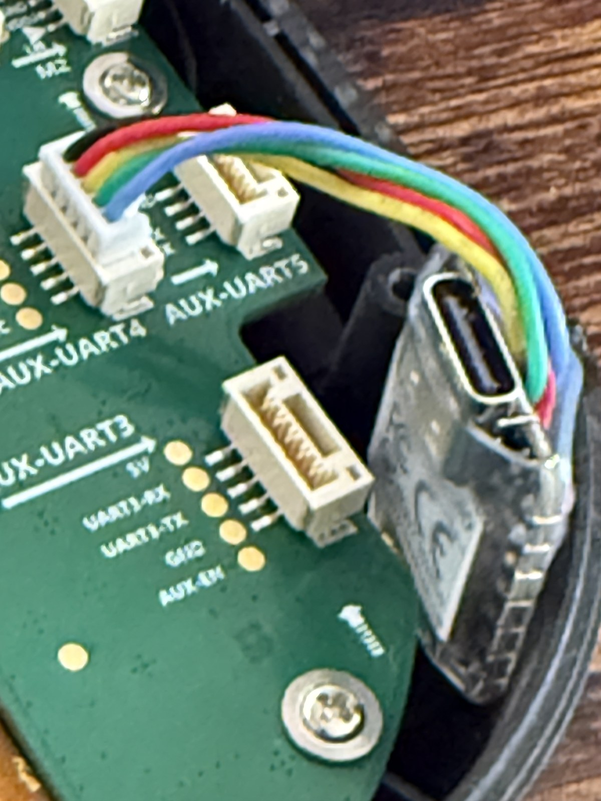

# TX15 hardware build example

These photos show an example **Seeed Studio XIAO ESP32-C5** wired for
ANCHOR and positioned inside a **RadioMaster TX15**. They illustrate the
module, harness, connector orientation, and placement.

Use the labelled pins and the [hardware / wire contract](../README.md#hardware--wire-contract)
to identify connections rather than copying wire colours. These photos
show an example assembly, not a complete electrical pinout or a verification
of the connections.

## XIAO ESP32-C5 module

The shield side identifies the board as a XIAO ESP32-C5. The harness is
routed past the USB-C connector, and an antenna cable is attached at the
opposite end of the module.

## Soldered harness

The other side shows the soldered wire connections and routing across the
board. Keep the board's pin labels as the reference when checking a build.

## Connector orientation

Close-up of the five-wire harness connector, viewed with the contact
openings facing the camera. This view records the example connector
orientation; it does not assign signal names or pin numbers to wire colours.

## Placement inside the TX15

The example positions the C5 beside the TX15 auxiliary UART connectors,
with the USB-C connector facing outward. The short harness connects the
module to the radio PCB.

## Firmware and checks

Follow the [illustrated USB flashing guide](USB-FLASHING.md) to install
ANCHOR. After assembling the module, verify Trainer channel mapping and
direction, then power-cycle both the radio and head tracker to check
automatic reconnection on the bench. See [BENCH-TEST.md](BENCH-TEST.md)
for the wider regression checklist.

Photos supplied by the project owner, 24 November 2026. Published copies
are resized for documentation and have camera metadata removed; image
content is otherwise unchanged.
