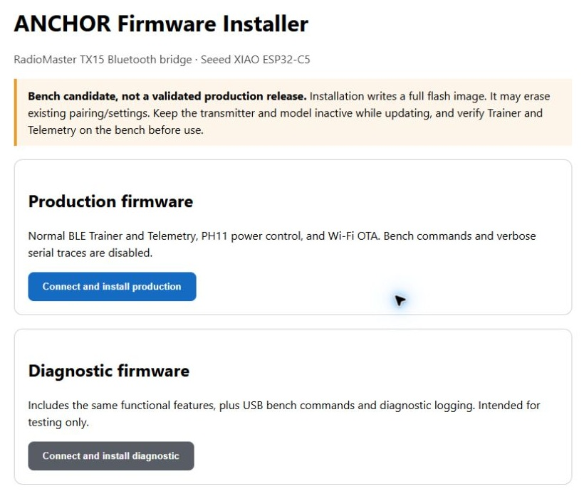
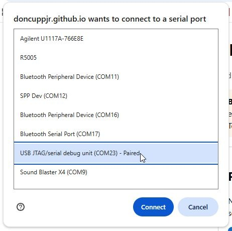
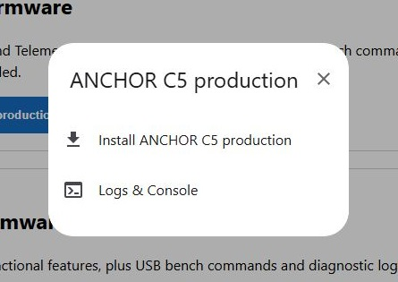
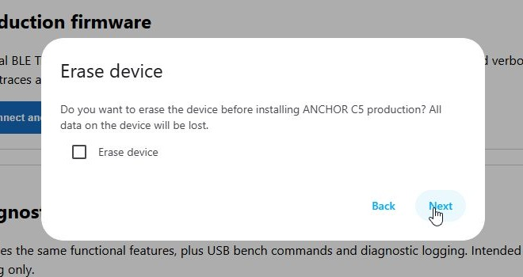
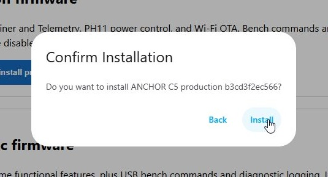
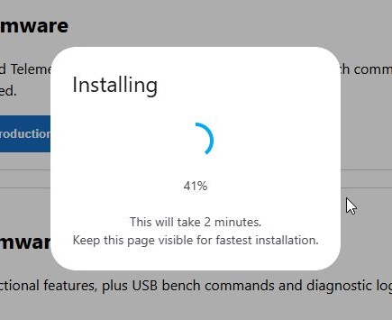
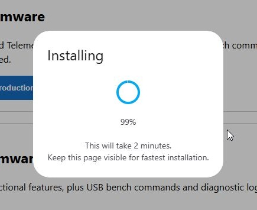
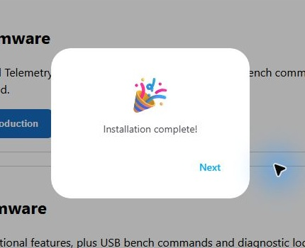
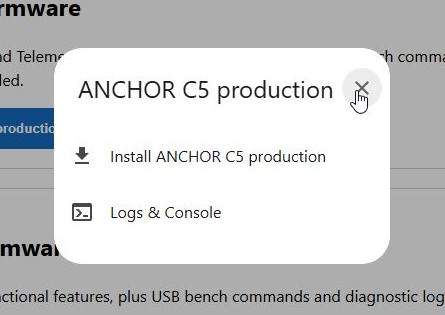
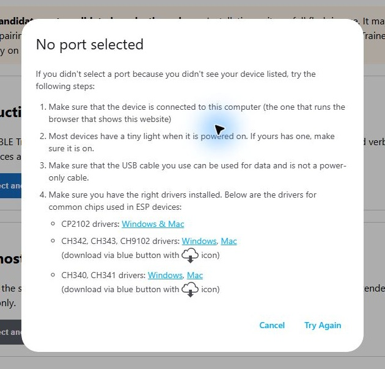

# Flash ANCHOR from the web installer

Install ANCHOR on a **Seeed XIAO ESP32-C5** for the RadioMaster TX15 using a
USB cable and the browser installer. No command-line tools are required.

**Open the installer:** <https://doncuppjr.github.io/anchor/>

> The installer labels the firmware a bench candidate, not a validated
> production release. A full USB flash may overwrite pairing and settings.
> Keep the transmitter and model inactive during installation, then verify
> operation on the bench before use.

## Before you start

- Use desktop Chrome or Edge with Web Serial support.
- Connect the C5 with a USB-C **data cable**, not a charging-only cable.
- If the C5 USB port is missing, hold **BOOT**, tap **RESET**, then release
  **BOOT** to enter ROM download mode. Retry the connection.
- Plan to pair the head tracker again if settings are lost. A successful
  firmware flash does not verify Trainer channel mapping or reconnection.

The ESP32-C5 uses the Espressif ROM serial loader for this installation,
not a UF2 drag-and-drop drive.

## 1. Choose Production

Click **Connect and install production**.

| Choice | Use |
| --- | --- |
| Production | Normal BLE Trainer and Telemetry, PH11 power control, and Wi-Fi OTA. USB bench commands and verbose serial traces are disabled. |
| Diagnostic | The same functional features, with USB bench commands and diagnostic logging for testing. The build/artifact variant is named `debug`. |

## 2. Select the C5 USB port

Select **USB JTAG/serial debug unit**, then click **Connect**. The example
below shows **COM23**; the COM number can differ on another computer.
Choose the C5 USB interface, rather than a Bluetooth serial port or another
connected device.

## 3. Open the installation wizard

Choose **Install ANCHOR C5 production**. **Logs & Console** opens serial
tools and does not start installation.

## 4. Review the erase choice

The **Erase device** checkbox requests an erase before installation.
Review the choice, then click **Next**.

| Choice | Meaning |
| --- | --- |
| Unchecked | Does not request the additional device erase. This was the choice in the captured walkthrough. The full image may still overwrite NVS pairing/settings; this is not a preservation guarantee. |
| Checked | Erases the device before installing. The dialog warns that all device data will be lost. Expect to configure and pair again. |

## 5. Confirm installation

Check the firmware name and build identifier, then click **Install**.
Use **Back** to revise the erase choice.

The captured example is build `b3cd3f2ec566`. Later builds will show a
different identifier; the screenshot does not pin the live installer to
this version.

## 6. Wait for the flash to finish

Keep the USB cable connected and the installer page visible. Do not reset
or unplug the C5 while it is installing. The dialog estimates two minutes;
wait for the explicit completion message rather than a particular percentage.

Additional progress capture at 99%

## 7. Verify completion

Wait for **Installation complete!**, then click **Next**.

This completion screenshot came from the earlier successful production
flash in the same documentation session. During the user-driven repeat,
the completion dialog advanced before another screenshot was taken.

## 8. Close the installer and bench-test

After **Next**, the installer returns to the connected-device menu. Close
it with **X**, then reset the C5. This menu alone is not proof of completion;
check the success message in the preceding step.

Before operating a model:

1. Reconnect the C5 to the TX15 and verify the UART/PH11 connections.
2. Pair the head tracker if necessary.
3. Check Trainer channel mapping, movement, and direction.
4. Power-cycle both devices and verify automatic reconnection and channel
   movement on the bench. Repeat with the devices powered on in either order.
5. If using Telemetry, verify that path separately.

The screenshots document the USB installation flow. They do not establish
TX15 Trainer/Telemetry operation, pairing retention, or power-cycle
reconnection. See [BENCH-TEST.md](BENCH-TEST.md) for the broader regression
checklist.

## Recovery: no port selected or C5 missing

Click **Try Again** to reopen the port chooser. If the C5 is absent:

1. Check the USB connection and use a data-capable cable.
2. Hold **BOOT**, tap **RESET**, then release **BOOT**.
3. Retry and select the C5 USB serial interface.

The C5 USB port disappeared after this board booted into Production.
Returning it to ROM download mode made its USB interface available again.
Do not substitute another connected device when the C5 is missing.

## USB images versus Wi-Fi OTA images

| Update path | Image |
| --- | --- |
| This USB web installer | CI-generated full merged image, written by the ESP32-C5 ROM loader. May overwrite pairing/settings. |
| Existing ANCHOR Wi-Fi OTA page | Application-only `ANCHOR-C5-production-app.bin` for Production. **Never upload a `*-full.bin` to the OTA page.** |

For manual USB flashing, build details, and OTA behavior, see the
[project README](../README.md). For the installer implementation and CI
packaging, see [installer/README.md](../installer/README.md).

Screenshots captured on Windows with Chrome, 24 November 2026. Dialog
styling, port numbers, and build identifiers may change.
